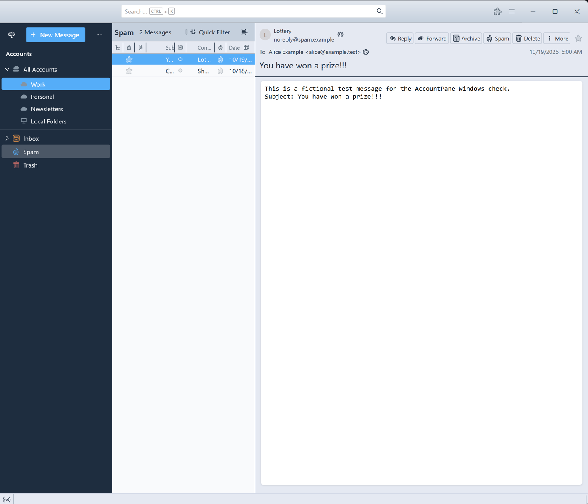
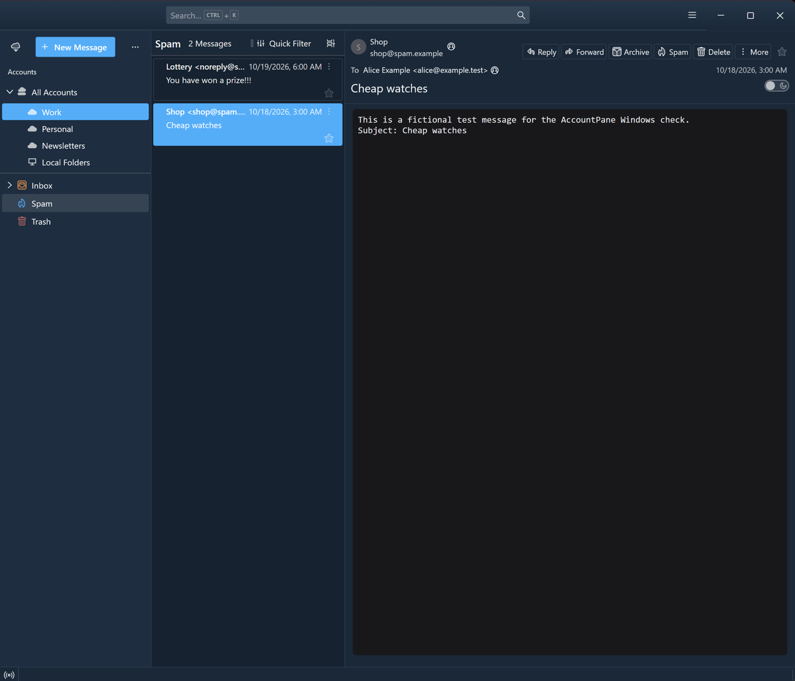

# Tangaroa for Thunderbird

**English** · [Русский](README.ru.md)

A Thunderbird theme that comes close to Postbox with its Tangaroa theme: a dark blue folder pane, a light message list and reading area, and the system font. It was made after Postbox stopped being updated, to keep the familiar look of mail in Thunderbird. The styles are an adaptation of [Postbird](https://github.com/Ocanamat/Postbird) with the Tangaroa palette.

The Postbox-style account list above the folder tree comes from a separate extension, [AccountPane](https://github.com/stupalov/thunderbird-account-pane). The theme and the extension are independent and can be used together.

## What you get

- The light Tangaroa look and a dark variant based on Postbox Midnight with Tangaroa's key colours. The variant switches with the system colour scheme.
- It works in both the table view and the card view of the message list.
- It styles the main window: toolbar, tabs, folder pane (including AccountPane rows), message list, message header and status bar.

## Screenshots

Thunderbird 158 with AccountPane in a test profile with fictional accounts (Windows 11).

*Light variant, table view.*

*Dark variant, card view. The message body keeps Thunderbird's dark-reader colours.*

## Installation

1. Download `tangaroa-<version>.xpi` from the [Releases](https://github.com/stupalov/thunderbird-tangaroa/releases) page.
2. In Thunderbird open **Add-ons and Themes**, click the gear button and choose **Install Add-on From File…**.
3. Select the downloaded file and confirm the installation.

The theme appears under **Themes** and is enabled. To switch back, choose another theme in the same place. Thunderbird 157 or 158 is required; the manifest names the versions the theme was checked on, and each new Thunderbird release gets a theme update.

## Light and dark

The theme follows the system colour scheme. The theme follows the system appearance only; Thunderbird's own light/dark override settings (the toolbar theme override and the message content colour-scheme override in the Config Editor) are not supported. The theme has no settings of its own.

Known limitation: in the dark variant the body of an open message is painted by Thunderbird's dark reader in Thunderbird's own dark grey, not in the theme's navy. A theme cannot style message content. Each message has a header toggle that shows it in light colours instead.

## Optional view settings

Table View, density and Classic layout are standard Thunderbird choices. They are not required, and the theme works with the defaults.

## Status

Beta. Checked with Thunderbird 158.0 on macOS 27 (light and dark system appearance, working profile with AccountPane) and on Windows 11 (light and dark, test profile). Details: [docs/testing.md](docs/testing.md).

## Development

See [docs/development.md](docs/development.md).

## More information

[Changelog](CHANGELOG.md) · [Attribution](ATTRIBUTION.md) · [License](LICENSE)

Tangaroa for Thunderbird is an independent project, not an official Thunderbird or Postbox product.
